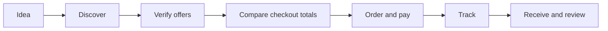

# DrinkDrink

从“想喝什么”到“收到饮品”的开源 Skill：发现选择、跨渠道和支付方式比价、核实优惠券、下单、跟踪履约、处理问题。项目提供通用流程、离线结算核对工具、本地订单记录，以及官方 MCP 接口模块目录；实际商家操作需要用户已连接的账户与工具，或可访问的应用界面。

A Codex skill and small offline tools for the full drink ordering life cycle: idea, discovery, comparison, purchase, fulfillment, receipt, and follow-up. It works with coffee, tea, and other drinks across delivery apps, brand mini programs, and pickup. Its comparator checks the buyer's actual checkout totals, coupon applicability, payment offers, fulfillment, and time. Official MCP modules now provide a common call boundary when an authenticated host connection is available; the repository itself does not log in or submit orders.



## Use

Install `drinkdrink/` as a skill in your agent's skills directory, or read [`drinkdrink/SKILL.md`](drinkdrink/SKILL.md) directly. The agent gathers live quotes through tools or app UI. Run the comparator with Python 3.10 or newer:

```sh
python3 drinkdrink/scripts/compare.py examples/quotes.json --at 2026-10-13T09:05:00+08:00
python3 drinkdrink/scripts/compare.py examples/quotes.json --at 2026-10-13T09:05:00+08:00 --format json
```

The example is synthetic. See [`quote-format.md`](drinkdrink/references/quote-format.md) for the input contract. A verified winner requires complete channel and incentive checks. This distinction matters when, for example, a Starbucks coupon works for 啡快 pickup but not 专星送 delivery.

To keep a local order timeline, see [`journal.md`](drinkdrink/references/journal.md). The journal accepts observed lifecycle states; it never polls a merchant or asserts payment on its own.

For an already connected Android device, a read-only ADB helper can list devices and save a local screenshot for visual inspection:

```sh
python3 drinkdrink/scripts/android_capture.py devices
python3 drinkdrink/scripts/android_capture.py screenshot --out private/current-screen.png
```

## Design boundaries

- Compare payable totals after verified instant discounts. Show wallet credit separately.
- Keep quotes provisional when a coupon, payment offer, channel, or checkout is unverified.
- Do not store account credentials, addresses, or private order history in the repository.
- Merchant rules change. Read them in the buyer's current app session; this project does not publish a static coupon catalog.

## Official provider modules

The [source inventory](drinkdrink/references/official-providers.md) and one-file-per-surface [catalog](drinkdrink/providers/manifests/) track official entry points, verified dates, access scope, and supported actions. The catalog currently has callable mappings for 瑞幸咖啡 and 麦当劳中国 MCP. 瑞幸's official CLI and Skill are upstream references; 美团's developer portal is research only because consumer ordering access is unverified.

```sh
python3 drinkdrink/scripts/provider_catalog.py list
python3 drinkdrink/scripts/provider_catalog.py show luckin_mcp
python3 drinkdrink/scripts/provider_catalog.py audit --max-age-days 90
```

`drinkdrink.providers.ProviderModule.call()` accepts a connected MCP tool caller injected by the host. It passes through the exact vendor arguments and raw response, checks declared and optionally live tool availability, and requires an authorization object tied to the exact arguments before order creation, cancellation, or coupon claiming. It does not install vendors' software or store tokens. See the [adapter contract](drinkdrink/references/adapter-contract.md) to connect a host and turn observed checkout data into a quote. These modules have been checked against documentation, not tested against an authenticated account.

## Channel integrations

The comparison model accepts multiple merchants, apps, mini programs, delivery or pickup paths, and payment methods. Each payment method that changes the total is a separate declared path. See the [adapter contract](drinkdrink/references/adapter-contract.md) for adding a channel. For channels without a verified consumer interface, an agent gathers checkout evidence through an available connector or app UI. The generic Android screenshot helper remains read-only.

## Development

```sh
python3 -m unittest discover -s tests -v
```

MIT licensed. Contributions for additional channel adapters are welcome when they use authorized access and preserve checkout verification.
